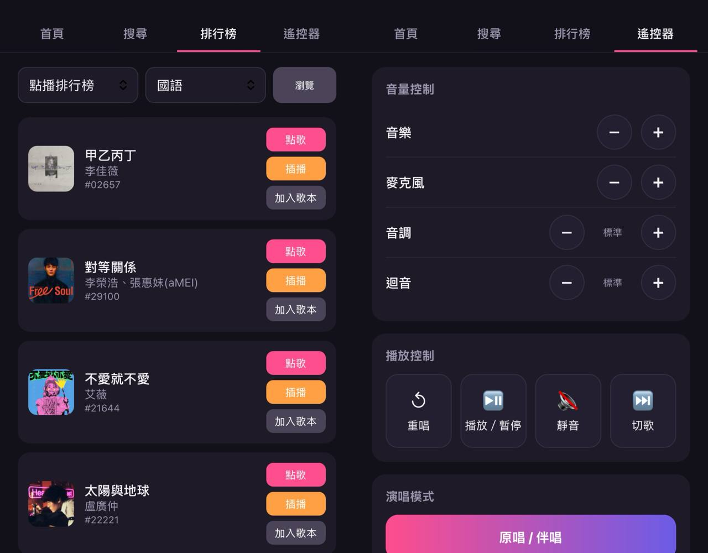

# KTV點歌（非官方）

在好樂迪包廂裡用手機瀏覽器點歌的自製網頁。輸入包廂內顯示的 4 位驗證碼就能搜歌、看排行榜、點歌／插播、
操作遙控器，不用另外裝 App。



> ⚠️ **免責聲明**
>
> - 本專案為個人學習與技術交流用途的**非官方**工具，與好樂迪（Holiday KTV）及其關係企業**沒有任何關係**，
>   未經其授權或認可。「好樂迪」等名稱與商標皆屬其各自所有人。
> - 本專案不包含任何好樂迪的程式碼、App 或素材，只是以一般使用者的身分、透過包廂提供的驗證碼呼叫其網頁服務。
> - 僅能在你實際使用中的包廂、以當次取得的驗證碼操作；請勿用於猜測他人包廂、大量請求或任何干擾對方服務的行為。
> - 本專案不收費、不做任何商業用途。官方服務隨時可能變更，本工具不保證可用性，使用風險請自行承擔。
> - 若權利人認為本專案有不妥之處，請開 issue 聯繫，會儘速配合調整或下架。

## 功能

- 搜尋歌名／歌手（同時搜尋並合併結果）
- 新進歌曲、新歌排行榜、點播排行榜（依語言分類）
- 點歌、插播、加入歌本
- 遙控器：音量、麥克風、升降 key、迴音、切歌、靜音、暫停、重唱、原唱／伴唱切換
- 顯示目前播放歌手；包廂退房後自動回到驗證碼畫面
- 裝置記住登入狀態，重新整理或服務重啟都不用再輸入驗證碼
- 管理後台（選用）：查看已登入裝置、操作紀錄、依裝置封鎖

## 架構

```
手機瀏覽器 → (反向代理，選用) → FastAPI 後端 (port 8000) → 好樂迪點歌網頁服務
```

- `app/main.py` — FastAPI 後端。代為呼叫上游服務，上游的 session cookie 只存在後端，前端碰不到。
- `app/static/index.html` — 單檔前端（無 build step），手機優先的深色 UI。
- `data/` — 登入 session、封鎖名單、操作紀錄（JSON 檔，重啟不會遺失）。

防濫用：同一來源 15 分鐘內驗證碼錯 5 次就暫時鎖定；搜尋與排行榜結果快取 60 秒，避免重複打上游。

## 自架

需要 Docker。

```bash
cp .env.example .env      # 要用管理後台的話填 ADMIN_PASSWORD，不填就關閉後台
docker compose up -d --build
```

`docker-compose.yml` 預設接到名為 `proxy_network` 的外部 Docker 網路（給反向代理用），沒有的話可以：

- 先建一個：`docker network create proxy_network`，或
- 把 `networks` 區塊拿掉，改加 `ports: ["8000:8000"]` 直接對外。

**必須走 HTTPS**：登入 cookie 設了 `secure`，純 HTTP 下瀏覽器不會存，會一直要求重新輸入驗證碼。

要掛在子路徑（例如 `https://example.com/ktv/`）的話，nginx 設定可參考 `deploy/nginx-ktv.conf`。前端的 API
路徑都是相對路徑，掛在根目錄或子路徑都能用。

管理後台：3 秒內連點標題 5 下會跳出管理員登入（密碼即 `.env` 的 `ADMIN_PASSWORD`）。

### 隱私

為了防濫用與封鎖，後端會在 `data/` 記錄使用者的裝置指紋、IP、User-Agent、螢幕尺寸、語言、包廂號碼與點歌／遙控操作紀錄
（操作紀錄只保留最近 300 筆）。這些屬於個人資料，**架站開放給他人使用時，請自行告知使用者並妥善保管**，
不需要時可直接刪除 `data/` 內的檔案。

## 已知限制

- 上游回應格式是從實際回應觀察來的，沒有官方文件；官方改版時可能會直接失效。
- 沒有做歌本列表、KKBOX 綁定。

## 授權

程式碼以 [MIT License](LICENSE) 釋出，上述免責聲明同樣適用。
